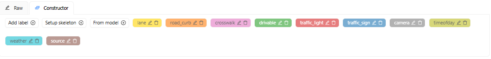
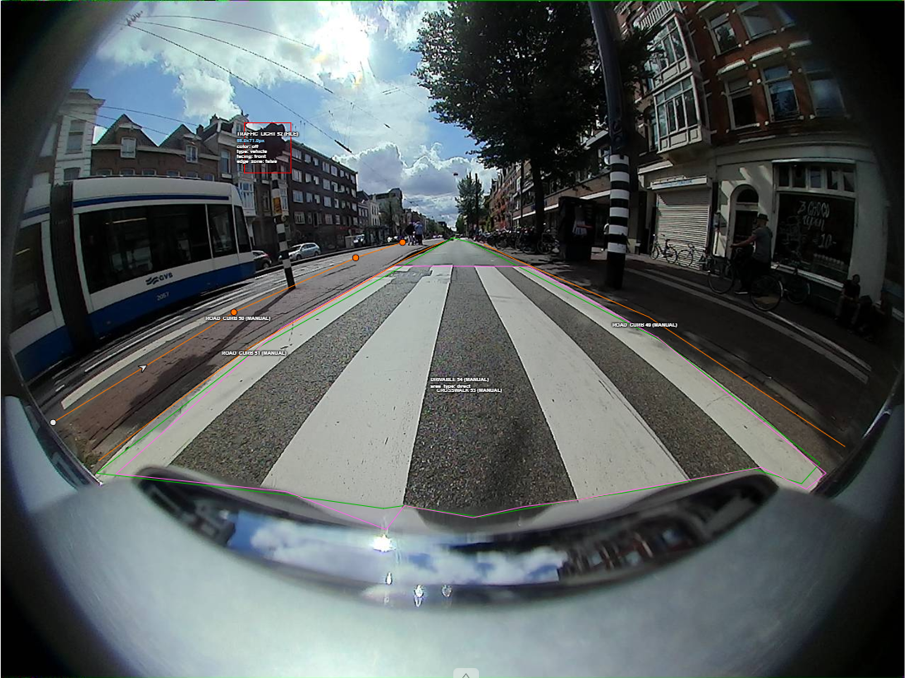

# Báo cáo cá nhân — Ngày 11
Họ tên: Do Anh Hoang
Mã học viên: 2a202604061
Phiên bản CVAT (Help → About): 2.74.1
Guideline: Road v1.0
Lần nộp (`revision` trong manifest): 2
Thời điểm export (ngày giờ trên CVAT): Lần 1: 11:00; lần 2: chưa ghi lại trên CVAT (manifest revision 2 tạo lúc 2026-11-21T04:51:34Z)
Số lần nộp lại sau Rework: 1

## 1. Kiểm project
| Mục | Đúng như guideline Road v1.0? | Ghi chú |
| --- | --- | --- |
| 6 label, đúng kiểu | Có | lane/road_curb: polyline; crosswalk/drivable: polygon; traffic_light/traffic_sign: box |
| Thuộc tính và giá trị | Đã rà theo QC và lint | Đã sửa position, kind, color, group và các vùng/polyline được nêu trong QC; lint vẫn nhắc thiếu L1/R1 ở A05, A06, A07 |
| 4 tag ảnh | Có | camera, timeofday, weather, source; manifest báo đủ tag trên 28/28 ảnh |
Cách kết thúc polyline trên bản CVAT này: Tạo polyline bằng các điểm trên tâm vạch; với vạch cong đặt thêm điểm theo cung.
Cách đặt tag ảnh trên bản CVAT này: Mỗi tag là một label Tag với một thuộc tính `value`.

## 2. Số lượng đã gán
| Task | Ảnh | lane | road_curb | crosswalk | drivable | traffic_light | traffic_sign |
| --- | ---: | ---: | ---: | ---: | ---: | ---: | ---: |
| front | 12 | 29 | 12 | 3 | 31 | 26 | 35 |
| front-extra (đã làm 4 / 4) | 4 | 12 | 5 | 4 | 12 | 8 | 11 |
| fisheye | 8 | 9 | 11 | 7 | 10 | 5 | 6 |
| fisheye-extra (đã làm 4 / 4) | 4 | 1 | 4 | 4 | 7 | 0 | 0 |

## 3. Bảng ca khó
| Ảnh | Nhãn | Phân vân giữa | Đã chọn | Lý do |
| --- | --- | --- | --- | --- |
| A01 | drivable | alternative và lề đường | Cắt bỏ polygon alternative tràn qua vạch R2 | Vùng lề ngoài vạch không phải vùng xe đi được |
| A04, A14 | lane | vạch vàng đôi | Một polyline ở tâm, `kind=double` | Guideline yêu cầu vạch đôi là một polyline |
| A08 | lane / drivable | vạch L2 bị tách; vùng direct tràn sang làn ngược chiều | Gộp polyline L2 và bỏ polygon tràn | Một vạch đứt dùng một polyline; không gán vùng đi ngược chiều |
| A16 | lane | L1 hay R1 | Đổi thành R1 | Vạch nằm bên phải làn đang đi |
| B01 | crosswalk | ranh với phần thân xe | Dời đỉnh polygon khỏi vùng phản chiếu trên cản trước | Không gán phần thân xe |
| B03 | traffic_sign | prohibitory hay information | Đổi thành information | Biển chỉ dẫn màu xanh dương |
| B12 | lane | đủ điểm cho cung fisheye | Bổ sung điểm theo cung | Fisheye cần polyline bám cung, không chỉ 3 điểm |

## 4. Phiếu QC 1 nhận được
Bạn kiểm lô của tôi: Phạm Trung Thành (`2A202604050`)
Quyết định ở revision 1: **Rework**
Người kiểm lấy mẫu 6 ảnh bắt buộc và 3 ảnh thêm, tổng 146 nhãn (102 ở ảnh bắt buộc; 44 ở ảnh thêm).

| Mã lỗi | Số lỗi | Đồng ý? | Đã sửa ở revision 2? |
| --- | ---: | --- | --- |
| QC1-02 | 2 | Có | Có — thêm R1 ở A14; sửa position lane phải thành R1 ở A16 |
| QC1-03 | 1 | Có | Có — A16 |
| QC1-05 | 3 | Có | Có — gộp vạch đôi ở A04, A14 và polyline L2 ở A08 |
| QC1-07 | 4 | Có | Có — sửa drivable ở A01, A04, A08 và crosswalk ở B01 |
| QC1-09 | 1 | Có | Có — B03 group thành information |
| QC1-11 | 1 | Có | Có — thêm điểm theo cung B12 |

Tổng kiểm: 3 lỗi nặng, 9 lỗi chính, 0 lỗi nhẹ; 9/146 = 6.16%. Phiếu ghi 6/102 = 5.88% trên ảnh bắt buộc, nhưng danh sách lỗi chi tiết liệt kê 7 lỗi chính trên ảnh bắt buộc (7/102 = 6.86%); đã ghi nhận sai khác này để người kiểm xác nhận. Dù dùng một trong hai số, quyết định vẫn là Rework. QC cho biết A03 không có lỗi. Các ảnh A05/A06/A07/A09 có cảnh báo lint thiếu L1/R1; người kiểm ghi không tính lỗi vì không thấy vạch sơn. Sau khi rework, lint không còn cảnh báo ở A09; A05/A06/A07 còn 4 cảnh báo QC1-02, cần coach xác nhận ngoại lệ trước khi nộp.

## 5. Kiểm file export
Đã mở lại hai ZIP bằng `road_check lint`; manifest revision 2 báo `contains_images: false`, 16 front + 12 fisheye, đủ tag trên mọi ảnh, không ảnh nào thiếu nhãn.

| File | Mở lại được? | Số shape ảnh 1 (job / file) | Số shape ảnh 2 (job / file) | Tag camera có trong XML? |
| --- | --- | --- | --- | --- |
| DoAnhHoang-front.zip | Có | A01: 3 drivable, 4 lane, 2 traffic_sign (9) | A02: 4 drivable, 3 lane, 2 road_curb (9) | Có |
| DoAnhHoang-fisheye.zip | Có | B01: 1 drivable, 1 crosswalk, 3 road_curb (5) | B02: 1 drivable, 1 crosswalk, 2 road_curb (4) | Có |

## 6. Ảnh chụp màn hình
1. Tab Labels của project: 
2. Ảnh camera trước đã gán: 
3. Ảnh fisheye đã gán: 
4. Ảnh chụp màn hình XML: chưa có. Trích đoạn XML từ ZIP revision 2 (thay cho ảnh chụp, cần chụp bổ sung nếu coach yêu cầu):

```xml
<polyline label="lane" source="manual" occluded="0" points="1279.00,705.70;1161.00,678.30;1023.00,645.20;886.10,611.70;749.30,577.20;608.50,543.50;467.60,511.50" z_order="3">
  <attribute name="position">R2</attribute>
  <attribute name="style">solid</attribute>
  <attribute name="color">yellow</attribute>
  <attribute name="kind">single</attribute>
</polyline>
```

Hai ảnh annotation phía trên là ảnh chụp trước Rework (revision 1); hiện chưa có ảnh chụp CVAT của revision 2.

## 7. Tự đánh giá
Lỗi nổi bật là QC1-07 (vùng drivable lấn sang lề hoặc làn ngược chiều) và QC1-05 (vạch bị tách thành nhiều polyline). Cần kiểm ranh giới vùng xe đi được và rà `position`/`kind` của từng vạch trước khi export.

Nhãn sai `drivable` làm mô hình học vùng mặt đường rộng hoặc lệch sang làn không thuộc hướng xe; vạch đôi bị biểu diễn thành hai đối tượng có thể khiến mô hình học sai cấu trúc làn và dự đoán không ổn định. Các lỗi này đã được sửa theo Phiếu QC 1 trong revision 2.
