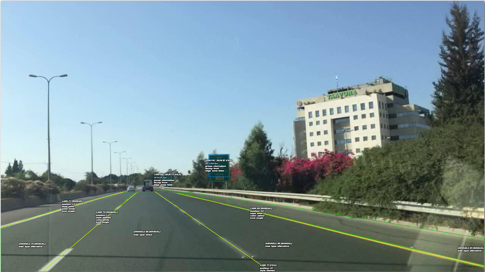

# Báo cáo cá nhân — Ngày 11
Họ tên: Do Anh Hoang
Mã học viên: 2a202604061
Phiên bản CVAT (Help → About): 2.74.1
Guideline: Road v1.0
Lần nộp (`revision` trong manifest): 1
Thời điểm export (ngày giờ trên CVAT): 11:00
Số lần nộp lại sau Rework: 0

## 1. Kiểm project
| Mục | Đúng như guideline Road v1.0? | Ghi chú |
| --- | --- | --- |
| 6 label, đúng kiểu | Có | lane/road_curb: polyline; crosswalk/drivable: polygon; traffic_light/traffic_sign: rectangle |
| Thuộc tính và giá trị | Cần xác nhận lại trong CVAT | XML lint báo còn một số ca mơ hồ L1/R1 và vạch fisheye |
| 4 tag ảnh | Có | camera, timeofday, weather, source |
Cách kết thúc polyline trên bản CVAT này: Polyline được tạo bằng nhiều điểm trên cung; không ghi lại thao tác kết thúc trong export
Cách đặt tag ảnh trên bản CVAT này: Tag label với một thuộc tính `value`

## 2. Số lượng đã gán
| Task | Ảnh | lane | road_curb | crosswalk | drivable | traffic_light | traffic_sign |
| --- | ---: | ---: | ---: | ---: | ---: | ---: | ---: |
| front | 12 | 33 | 12 | 3 | 36 | 26 | 35 |
| front-extra (đã làm 4 / 4) | 4 | 12 | 5 | 4 | 12 | 8 | 11 |
| fisheye | 8 | 9 | 11 | 7 | 10 | 5 | 6 |
| fisheye-extra (đã làm 4 / 4) | 4 | 1 | 4 | 4 | 7 | 0 | 0 |

## 3. Bảng ca khó
| Ảnh | Nhãn | Phân vân giữa | Đã chọn | Lý do |
| --- | --- | --- | --- | --- |
| B09–B12 | camera | front/fisheye_front/fisheye_rear/fisheye_left/fisheye_right | Giá trị theo hậu tố tên ảnh | FV/rear/left/right đã được đối chiếu theo hậu tố WoodScape |
| B08 | lane | position của camera hai bên | other | Áp dụng quy tắc fisheye ở camera hai bên |
| B12 | lane | chiều vẽ | Từ xa đến gần xe | Đã đảo thứ tự điểm để polyline đi từ xa ra gần |

## 4. Phiếu QC 1 nhận được
Bạn kiểm lô của tôi: phamtrungthanh
Quyết định nhận được: Chưa ghi / chưa được cung cấp đủ dữ liệu
| Mã lỗi | Số lỗi | Đồng ý? | Đã sửa? |
| --- | ---: | --- | --- |
| Chưa cung cấp | Chưa cung cấp | Chưa xác nhận | Chưa xác nhận |

## 5. Kiểm file export
| File | Mở lại được? | Số shape ảnh 1 (job / file) | Số shape ảnh 2 (job / file) | Tag camera có trong XML? |
| --- | --- | --- | --- | --- |
| DoAnhHoang-front.zip | Có | A01: 4 drivable, 4 lane / 8 shape; A02: 4 drivable, 3 lane, 2 road_curb / 9 shape | Mỗi ZIP đã mở lại bằng lint; xem XML ở 2 ảnh đầu | Có |
| DoAnhHoang-fisheye.zip | Có | B01: 1 drivable, 1 crosswalk, 3 road_curb / 5 shape; B02: 1 drivable, 1 crosswalk, 2 road_curb / 4 shape | Mỗi ZIP đã mở lại bằng lint; xem XML ở 2 ảnh đầu | Có |

## 6. Ảnh chụp màn hình
1. Tab Labels của project: 
2. Một ảnh camera trước đã gán đủ (làn, vùng lái, đèn/biển): 
3. Một ảnh fisheye đã gán: 
4. Một đoạn XML có `<polyline label="lane">`: Chưa có ảnh chụp màn hình thực tế.

## 7. Tự đánh giá
Lỗi bạn mắc nhiều nhất hôm nay (theo mã QC1-xx), và cách tránh ở Ngày 20:
Chưa được cung cấp Phiếu QC 1 hoàn chỉnh; ưu tiên kiểm lại tag camera, L1/R1, position và hướng polyline.

Nhãn của bạn đi vào model ở đâu? Chọn một lỗi đã sửa và nói nó làm model học sai thế nào:
Nếu camera fisheye bị gắn nhầm `front`, model sẽ học sai hướng quan sát và có thể kết hợp sai đặc trưng thị giác giữa front/rear/left/right. Việc sửa camera theo hậu tố ảnh giúp model có metadata đúng cho từng góc camera.

